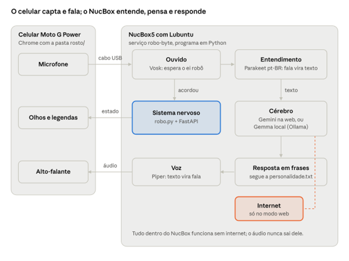

# Robô Byte: tecnologias e organização do projeto

Oct 25, 2026

## Visão geral

O Byte é um robô de mesa que ouve uma pergunta, entende, pensa e responde falando, em português do Brasil. Ele é montado com um computador e um celular reaproveitados, e quase tudo roda sem internet.



O celular é a "interface": mostra os olhos e cuida do som. O NucBox faz todo o trabalho pesado. A internet só entra quando o cérebro está no modo web, e mesmo assim só recebe o texto da pergunta.

## Os equipamentos

O robô é feito com dois aparelhos reaproveitados, ligados por um cabo USB. O computador pensa; o celular é o rosto, os ouvidos e a boca.

| Aparelho | Modelo | Papel no robô |
| --- | --- | --- |
| Computador | GMKtec NucBox5 (Celeron N5095, 4 núcleos, 8 GB de memória) | O "cérebro": roda todos os programas de inteligência artificial |
| Celular | Motorola Moto G Power 2022 (tela de 6,5", Android) | O "rosto": mostra os olhos, capta a voz com o microfone e fala pelo alto-falante |
| Cabo USB | USB-C | Carrega o celular e leva os dados entre os dois |

O processador do NucBox é modesto e não tem as instruções AVX2, que deixam a inteligência artificial mais rápida. Por isso o projeto usa modelos pequenos e, quando há internet, uma IA na web para pensar mais rápido.

## As tecnologias

Cada tarefa do robô é feita por um programa especializado. Quase todos são gratuitos, de código aberto e funcionam sem internet.

| Parte do robô | Tecnologia | O que faz | Onde roda | Precisa de internet? |
| --- | --- | --- | --- | --- |
| Sistema operacional | Lubuntu (Linux) | Base que liga o computador e roda tudo | NucBox | Não |
| Linguagem | Python | Linguagem em que o programa do robô foi escrito | NucBox | Não |
| Ponte com o celular | FastAPI + Uvicorn | Servidor que entrega a página do rosto e troca mensagens com o celular (WebSocket) | NucBox | Não |
| Cabo de dados | adb (Android Debug Bridge) | Faz o celular enxergar o robô pelo cabo e controla a tela | NucBox ↔ celular | Não |
| Rosto | HTML, CSS e JavaScript no Chrome | Desenha os olhos, mostra legendas, grava o microfone e toca a voz | Celular | Não |
| Palavra de ativação | Vosk (modelo pequeno em português) | Fica atento a "ei robô" o tempo todo, gastando pouco | NucBox | Não |
| Entendimento | Parakeet pt-BR (TAGARELA), pelo onnx-asr | Transforma a fala em texto (cerca de 1,7 s) | NucBox | Não |
| Entendimento reserva | Whisper (faster-whisper) | Mesma tarefa, se o Parakeet for desligado no config | NucBox | Não |
| Cérebro na web | Google Gemini (pelo padrão "compatível com OpenAI") | Pensa na resposta, rápido e mais esperto | Internet | Sim |
| Cérebro local | Ollama + Gemma 3 1B | Pensa na resposta sem internet; é a reserva quando a web falha | NucBox | Não |
| Voz | Piper, voz brasileira "faber" | Transforma a resposta em fala | NucBox | Não |
| Início automático | systemd (serviço `robo-byte`) | Liga o robô com o computador e religa se cair | NucBox | Não |

Para cada tarefa existe uma reserva: se a IA da web não responder, o Gemma local responde; se o Parakeet for desligado, o Whisper entende a fala.

## O caminho de uma pergunta

Do "ei robô" até a resposta falada, a conversa passa por quatro estados, que o rosto mostra na tela.

1. **Dormindo** (olhos fechados, "z z z"): o microfone do celular manda o som para o NucBox o tempo todo, e o Vosk procura só a palavra de ativação ("ei robô", "eu robô", "oi robô" ou "olá robô"). Tocar na tela também acorda o robô.
2. **Ouvindo** (olhos grandes e verdes): o robô grava a pergunta até a pessoa ficar 1,2 segundo em silêncio.
3. **Pensando** (olhos laranja e pontinhos): o Parakeet transforma a gravação em texto. O texto, junto com a personalidade e as últimas conversas, vai para o cérebro (Gemini na web ou Gemma local).
4. **Falando** (boca mexendo e legenda): cada frase da resposta vira áudio no Piper e vai para o celular. Enquanto o celular fala uma frase, o NucBox já prepara a próxima.

Depois de falar, o robô espera mais uma pergunta por 6 segundos sem precisar da palavra de ativação. Se ninguém falar, volta a dormir. Enquanto pensa e fala, ele não escuta, para não confundir a própria voz com a de alguém.

O áudio nunca sai do NucBox. No modo web, só o texto da pergunta vai para a internet.

## Lubuntu e o início automático

O NucBox usa o **Lubuntu**, uma versão leve do Linux Ubuntu. Ele gasta menos memória e processador que o Windows, o que sobra para a inteligência artificial. Basta ligar o NucBox na tomada: em poucos minutos o rosto aparece no celular, sem ninguém tocar em nada.

O que acontece quando a energia chega:

1. **BIOS:** a opção "Restore on AC Power Loss = Power On" liga o computador sozinho.
2. **Lubuntu:** o sistema inicia e liga os serviços. Serviço é um programa que o Linux mantém rodando em segundo plano, sem ninguém precisar entrar no usuário.
3. **Serviço `ollama`:** liga o cérebro local.
4. **Serviço `robo-byte`:** roda o `ferramentas/automatico.py`, o "piloto automático", que:
   - confere se o Ollama está no ar e, se não estiver, liga o Ollama;
   - liga o servidor do robô e espera ele carregar os modelos;
   - quando o celular aparece no cabo, abre o caminho (`adb reverse`), mantém a tela ligada, deixa na horizontal, abre o rosto no Chrome e toca na tela para liberar som e microfone;
   - religa o robô se ele cair e prepara o celular de novo se o cabo sair e voltar.

O que o script `ativar_modo_automatico.sh` configura, uma vez só:

| Configuração | Para quê | Onde fica |
| --- | --- | --- |
| Serviço `robo-byte` | Ligar o robô com o computador e religar se cair | `/etc/systemd/system/robo-byte.service` |
| Regra USB do Motorola | Deixar o robô usar o celular pelo cabo sem senha de administrador | `/etc/udev/rules.d/51-robo-celular.rules` |
| Suspensão desligada | Impedir o computador de dormir | serviços `sleep`, `suspend` e `hibernate` bloqueados |

Ajustes feitos à mão, uma vez:

- **BIOS do NucBox:** "Restore on AC Power Loss" em "Power On".
- **Celular:** depuração USB ligada, com "Sempre permitir deste computador".
- **Celular:** bloqueio de tela "Nenhum" e microfone permitido uma vez no Chrome.
- **Celular:** sempre ligado no cabo. Se ele desligar de vez, é preciso ligá-lo à mão.

## Pastas, arquivos e configurações

O projeto fica em `~/robo-assistente`. Cada arquivo da pasta `robo` é uma "parte do corpo" e pode ser testado sozinho.

```
robo-assistente/
├── robo/                      o programa do robô (NucBox)
│   ├── config.py              painel de controle
│   ├── personalidade.txt      jeito de ser do robô
│   ├── servidor.py            ponte com o celular
│   ├── robo.py                sistema nervoso: liga as partes
│   ├── ouvido.py              palavra de ativação e gravação (Vosk)
│   ├── transcricao.py         fala vira texto (Parakeet ou Whisper)
│   ├── cerebro.py             pensa na resposta (Gemini ou Gemma)
│   └── voz.py                 texto vira fala (Piper)
├── rosto/                     a página que abre no celular
├── ferramentas/
│   ├── automatico.py          piloto automático
│   └── baixar_modelos.py      baixa os modelos
├── instalar.sh                instala tudo (uma vez, com internet)
├── iniciar.sh                 liga o robô à mão, para testes
├── ativar_modo_automatico.sh  liga sozinho com o computador
├── desativar_modo_automatico.sh
├── requirements.txt           lista de bibliotecas Python
├── chave_web.txt              chave da IA da web (secreta, criada à mão)
├── modelos/                   modelos baixados (criada pelo instalador)
└── .venv/                     bibliotecas instaladas (criada pelo instalador)
```

Os ajustes principais ficam no `robo/config.py`. Depois de mudar, reinicie o robô.

| Ajuste | Valor atual | Para que serve |
| --- | --- | --- |
| `PALAVRAS_DE_ATIVACAO` | ei, eu, oi e olá robô | Frases que acordam o robô |
| `MOTOR_ENTENDIMENTO` | parakeet | Quem transforma fala em texto: `parakeet` ou `whisper` |
| `CEREBRO` | web | Quem pensa: `web` (internet) ou `local` (sem internet) |
| `WEB_MODELO` | gemini-3.8-flash | Qual IA da web usar |
| `MODELO_IA` | gemma3:1b | Cérebro local, também usado como reserva |
| `TAMANHO_MAXIMO_DA_RESPOSTA` | 300 | Limite de tamanho da resposta, em tokens (pedaços de palavra) |
| `CRIATIVIDADE` | 0,3 | Mais baixo deixa as respostas mais diretas e com menos invenção |
| `LIMIAR_DE_SILENCIO` | 600 | Quanto barulho conta como fala; aumente em sala barulhenta |
| `SEGUNDOS_DE_SILENCIO_PARA_PARAR` | 1,2 | Pausa que encerra a pergunta |

Para mudar o jeito do robô, edite o `robo/personalidade.txt`. É texto comum, escrito como uma orientação para a IA.

## Comandos do dia a dia e cuidados

Todos os comandos são digitados no terminal do Lubuntu (QTerminal).

| Para | Comando |
| --- | --- |
| Ver o que o robô está fazendo, ao vivo | `journalctl -u robo-byte -f` |
| Ver só o que ele ouviu e os tempos | `journalctl -u robo-byte -f \| grep -E "ouvi:\|tempo"` |
| Saber se o robô está rodando | `systemctl status robo-byte` |
| Reiniciar o robô (depois de mudar o config) | `sudo systemctl restart robo-byte` |
| Parar o robô até o próximo reinício | `sudo systemctl stop robo-byte` |
| Conferir se o celular está conectado | `adb devices` |
| Desligar o modo automático | `./desativar_modo_automatico.sh` |
| Testar o cérebro pelo teclado | `.venv/bin/python -m robo.cerebro` |

Cuidados:

- **Chave da IA da web:** o arquivo `chave_web.txt` é pessoal. Não compartilhe e não coloque em cópias do projeto.
- **Privacidade:** o robô não grava áudio em arquivo, e a memória das conversas some quando ele reinicia. No modo web, o texto das perguntas vai para o Google. Avise a turma e a escola de que o robô escuta quando é chamado.
- **Bateria do celular:** deixe ventilação atrás dele e veja de vez em quando se a bateria não está estufando.
- **Carcaça:** o NucBox esquenta sob carga (cerca de 69 °C em teste pesado), então a carcaça precisa de entradas e saídas de ar.
- **Cópia de segurança:** guarde um zip só com o código (pastas `robo`, `rosto` e `ferramentas`, os scripts e o `requirements.txt`), sem `.venv`, `modelos` e `chave_web.txt`. Para reinstalar, descompacte e rode `bash instalar.sh`.
