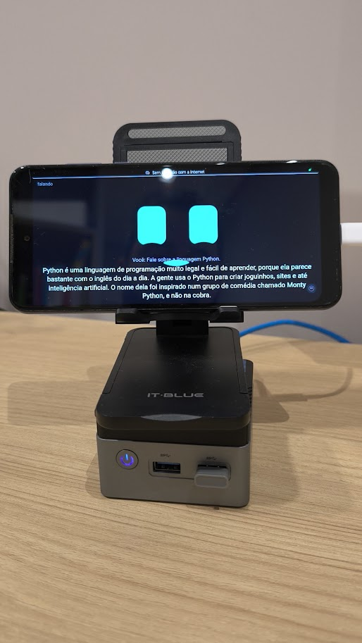
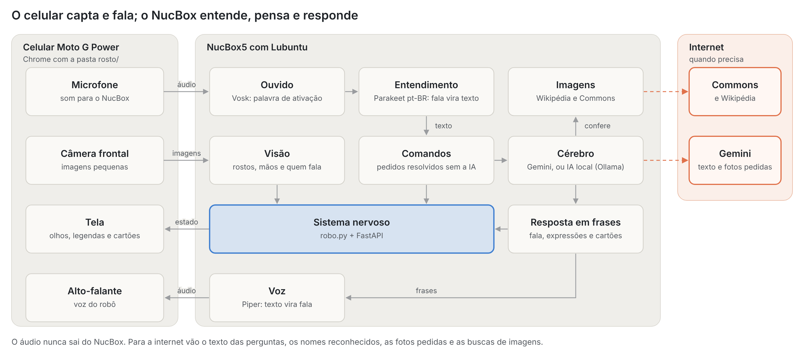

# Robô Byte

Robô de mesa que ajuda em aulas de informática. Ele ouve uma pergunta, entende, pensa e responde falando, em português do Brasil.

O Byte é montado com um computador pequeno e um celular reaproveitado. A voz, o entendimento da fala e o reconhecimento de rostos rodam no próprio computador, sem internet. A internet é usada para a IA mais esperta e para buscar imagens.



## O que ele faz

- **Conversa por voz:** acorda com "ei robô" ou com um toque na tela, responde em voz alta e mostra legendas.
- **Reconhece pessoas:** aprende rostos, cumprimenta pelo nome e sabe quem está na frente da câmera.
- **Enxerga:** tira fotos, descreve o que vê e lê o quadro.
- **Mostra imagens:** busca na Wikipédia e no Wikimedia Commons, confere com a IA e explica para a turma.
- **Tem expressões:** mostra alegria, dúvida, surpresa e sono.
- **Usa a tela para ensinar:** mostra listas, passos e textos enquanto fala.
- **Presta atenção:** olha para quem está falando e percebe uma mão levantada pedindo a vez.

A lista completa de frases está em [COMANDOS-ROBO-BYTE.md](COMANDOS-ROBO-BYTE.md).

## Como funciona



O celular é a interface: mostra o rosto e cuida do microfone, da câmera e do alto-falante. O NucBox faz o trabalho pesado.

## Equipamentos

| Aparelho | Modelo | Papel no robô |
| --- | --- | --- |
| Computador | GMKtec NucBox5 (Celeron N5095, 4 núcleos, 8 GB de memória) | O "cérebro": roda o programa do robô e os modelos de IA |
| Celular | Motorola Moto G Power 2022 (tela de 6,5", Android) | O "rosto": tela, microfone, câmera frontal e alto-falante |
| Cabo USB | USB-C | Carrega o celular e leva os dados entre os dois |

O processador do NucBox é modesto e não tem as instruções AVX. Por isso, o projeto usa modelos pequenos e, quando há internet, uma IA na web.

## Tecnologias

| Parte do robô | Tecnologia | O que faz | Onde roda | Precisa de internet? |
| --- | --- | --- | --- | --- |
| Sistema operacional | Lubuntu (Linux) | Base que roda tudo | NucBox | Não |
| Linguagem | Python | Programa do robô | NucBox | Não |
| Ponte com o celular | FastAPI e Uvicorn | Entrega a página do rosto e troca mensagens por WebSocket | NucBox | Não |
| Cabo de dados | adb (Android Debug Bridge) | Faz o celular enxergar o robô pelo cabo e controla a tela | NucBox e celular | Não |
| Rosto | HTML, CSS, JavaScript e Canvas 2D no Chrome | Desenha o rosto, mostra cartões e legendas, grava o som e toca a voz | Celular | Não |
| Palavra de ativação | Vosk | Fica atento às palavras de ativação, gastando pouco | NucBox | Não |
| Entendimento | Parakeet pt-BR (TAGARELA), pelo onnx-asr | Transforma a fala em texto (cerca de 1,7 s) | NucBox | Não |
| Entendimento reserva | Whisper (faster-whisper) | Faz a mesma tarefa, se for escolhido no `config.py` | NucBox | Não |
| Cérebro na web | Google Gemini, por API compatível com OpenAI | Pensa na resposta e analisa fotos | Internet | Sim |
| Cérebro local | Ollama | Pensa na resposta sem internet; é a reserva da web | NucBox | Não |
| Voz | Piper, voz "faber" | Transforma a resposta em fala | NucBox | Não |
| Rostos | OpenCV, YuNet e SFace | Acha e reconhece rostos | NucBox | Não |
| Mãos | Detector de palmas do OpenCV Zoo, pelo onnxruntime | Percebe a mão levantada | NucBox | Não |
| Imagens | API da Wikipédia e do Wikimedia Commons | Busca imagens livres para a aula | Internet | Sim |
| Início automático | systemd (serviço `robo-byte`) | Liga o robô com o computador e religa se cair | NucBox | Não |

## Instalação

Você vai precisar de um computador com Lubuntu ou outro Linux parecido, um celular Android com depuração USB ligada e internet durante a instalação.

```bash
cd ~
git clone ENDERECO_DO_REPOSITORIO robo-assistente
cd robo-assistente
bash instalar.sh
```

O instalador coloca os programas, as bibliotecas e os modelos. Ele cria o cérebro local com o nome `tucano2`, então confira se `MODELO_IA`, em `robo/config.py`, tem esse mesmo nome.

Para usar a IA na web, crie uma chave no Google AI Studio e salve no arquivo `chave_web.txt`, na pasta do projeto. Sem a chave, o robô usa o cérebro local.

Para buscar imagens, coloque seu e-mail em `IMAGENS_CONTATO`, em `robo/config.py`. A Wikipédia e o Commons exigem um contato de quem usa a busca.

O passo a passo completo está em [LEIA-ME-LINUX.md](LEIA-ME-LINUX.md).

## Como usar

**Para testar:** ligue o celular no cabo, rode o comando abaixo e abra `http://localhost:8000` no Chrome do celular. Depois, toque na tela e permita o microfone e a câmera.

```bash
./iniciar.sh
```

**Para ligar sozinho com o computador:**

```bash
./ativar_modo_automatico.sh
```

## O caminho de uma pergunta

1. **Dormindo:** o Vosk procura a palavra de ativação. Tocar na tela também acorda o robô.
2. **Ouvindo:** o robô grava a pergunta até a pessoa ficar 1 segundo em silêncio.
3. **Pensando:** o Parakeet transforma a gravação em texto. Pedidos como "tira uma foto" são resolvidos na hora, e o restante vai para o cérebro.
4. **Falando:** cada frase vira áudio no Piper. Enquanto o celular fala uma frase, o NucBox prepara a próxima.

Depois de falar, o robô espera outra pergunta por 4 segundos, sem precisar da palavra de ativação. Enquanto pensa e fala, ele não escuta, para não confundir a própria voz com a de alguém.

## Modo automático

Depois de ativado, basta ligar o NucBox na tomada. O serviço `robo-byte` roda o `ferramentas/automatico.py`, que:

- confere se o Ollama está no ar e o liga, se preciso;
- liga o servidor do robô e espera os modelos carregarem;
- quando o celular aparece no cabo, abre o caminho com `adb reverse`, mantém a tela ligada, deixa na horizontal, abre o rosto no Chrome e toca na tela para liberar o som;
- religa o robô se ele cair e prepara o celular de novo se o cabo sair e voltar.

Alguns ajustes são feitos à mão, uma vez:

- **BIOS do NucBox:** "Restore on AC Power Loss" em "Power On".
- **Depuração USB:** ligada no celular, com "Sempre permitir deste computador".
- **Celular:** bloqueio de tela "Nenhum", com microfone e câmera permitidos no Chrome.

## Estrutura do projeto

```text
robo-assistente/
├── robo/                       programa do robô (NucBox)
│   ├── config.py               painel de controle
│   ├── personalidade.txt       jeito de ser do robô
│   ├── servidor.py             ponte com o celular
│   ├── robo.py                 sistema nervoso: liga as partes
│   ├── ouvido.py               palavra de ativação e gravação
│   ├── transcricao.py          fala vira texto
│   ├── comandos.py             pedidos resolvidos sem a IA
│   ├── cerebro.py              pensa na resposta
│   ├── marcas.py               expressões e cartões pedidos pela IA
│   ├── voz.py                  texto vira fala
│   ├── visao.py                acha rostos e mãos e reconhece pessoas
│   ├── atencao.py              descobre quem fala e quem pede a vez
│   └── imagens.py              busca na Wikipédia e no Commons
├── rosto/                      página que abre no celular
├── ferramentas/
│   ├── automatico.py           piloto automático
│   ├── baixar_modelos.py       baixa os modelos
│   └── rostos.py               lista, renomeia e apaga rostos
├── instalar.sh                 instala tudo
├── iniciar.sh                  liga o robô à mão
├── ativar_modo_automatico.sh   liga sozinho com o computador
├── desativar_modo_automatico.sh
├── Modelfile.tucano2           cria o cérebro local no Ollama
├── requirements.txt            bibliotecas Python
├── COMANDOS-ROBO-BYTE.md       tudo o que o robô entende
└── LEIA-ME-LINUX.md            guia de instalação e uso
```

Estes itens são criados na instalação ou no uso e não devem ir para o repositório: `chave_web.txt`, `.venv/`, `modelos/`, `dados/` e `fotos/`.

## Configurações principais

Os ajustes ficam em `robo/config.py`. Depois de mudar, reinicie o robô com `sudo systemctl restart robo-byte`.

| Ajuste | Valor padrão | Para que serve |
| --- | --- | --- |
| `PALAVRAS_DE_ATIVACAO` | "ei robô", "oi byte" e outras | Frases que acordam o robô |
| `MOTOR_ENTENDIMENTO` | `parakeet` | Quem transforma fala em texto: `parakeet` ou `whisper` |
| `CEREBRO` | `web` | Quem pensa: `web` ou `local` |
| `WEB_MODELO` | `gemini-3.5-flash-lite` | Qual IA da web usar |
| `MODELO_IA` | `qwen2.5:0.5b` | Cérebro local e reserva da web |
| `TAMANHO_MAXIMO_DA_RESPOSTA` | 380 | Limite da resposta, em tokens |
| `CRIATIVIDADE` | 0,3 | Mais baixo deixa as respostas mais diretas |
| `LIMIAR_DE_SILENCIO` | 600 | Quanto barulho conta como fala |
| `SEGUNDOS_DE_SILENCIO_PARA_PARAR` | 1 | Pausa que encerra a pergunta |
| `SEGUNDOS_ESPERANDO_PERGUNTA` | 4 | Tempo de espera por uma pergunta |
| `IMAGENS_FONTES` | `wikipedia`, `commons` | Onde buscar imagens |
| `VISAO_OLHAR_QUEM_FALA` | `True` | Liga o olhar para quem está falando |
| `VISAO_MAO_LEVANTADA` | `True` | Liga a detecção da mão levantada |
| `ROSTO_IA_ESCOLHE_EXPRESSAO` | `True` | Deixa a IA da web escolher as expressões |
| `TELA_IA_PODE_MOSTRAR` | `True` | Deixa a IA da web mostrar cartões na tela |

Para mudar o jeito do robô, edite `robo/personalidade.txt`.

## Comandos úteis

| Para | Comando |
| --- | --- |
| Ver o que o robô está fazendo | `journalctl -u robo-byte -f` |
| Ver só o que ele ouviu e os tempos | `journalctl -u robo-byte -f \| grep -E "ouvi:\|tempo"` |
| Saber se o robô está rodando | `systemctl status robo-byte` |
| Reiniciar o robô | `sudo systemctl restart robo-byte` |
| Parar até o próximo reinício | `sudo systemctl stop robo-byte` |
| Conferir o celular no cabo | `adb devices` |
| Desligar o modo automático | `./desativar_modo_automatico.sh` |
| Conversar pelo teclado | `.venv/bin/python -m robo.cerebro` |
| Testar a voz | `.venv/bin/python -m robo.voz` |
| Ver qual comando uma frase vira | `.venv/bin/python -m robo.comandos` |
| Ver rostos e mãos numa foto | `.venv/bin/python -m robo.visao foto.jpg` |
| Testar a busca de imagens | `.venv/bin/python -m robo.imagens placa-mãe` |
| Ver quem o robô conhece | `.venv/bin/python ferramentas/rostos.py listar` |

## Privacidade

- **Áudio:** nunca sai do NucBox e não é gravado em arquivo.
- **Texto:** no modo web, o texto das perguntas vai para o Google. Os nomes das pessoas reconhecidas também vão, a menos que `VISAO_CONTAR_NOMES_PARA_IA` seja `False`.
- **Câmera:** o reconhecimento roda no NucBox. Uma foto só vai para a IA da web quando alguém pede para o robô olhar, e a tela mostra um aviso.
- **Rostos:** `dados/rostos.json` guarda assinaturas numéricas, não fotos. Rosto é dado biométrico sensível, então peça autorização dos responsáveis e da escola antes de cadastrar alunos.
- **Imagens:** as buscas vão para a Wikipédia e o Commons, com o contato de `IMAGENS_CONTATO`. As imagens não são gravadas em disco.
- **Memória:** a conversa fica só na memória e some quando o robô reinicia. As fotos de "tira uma foto" ficam em `fotos/`.

Avise a turma e a escola de que o robô escuta e usa uma câmera.
